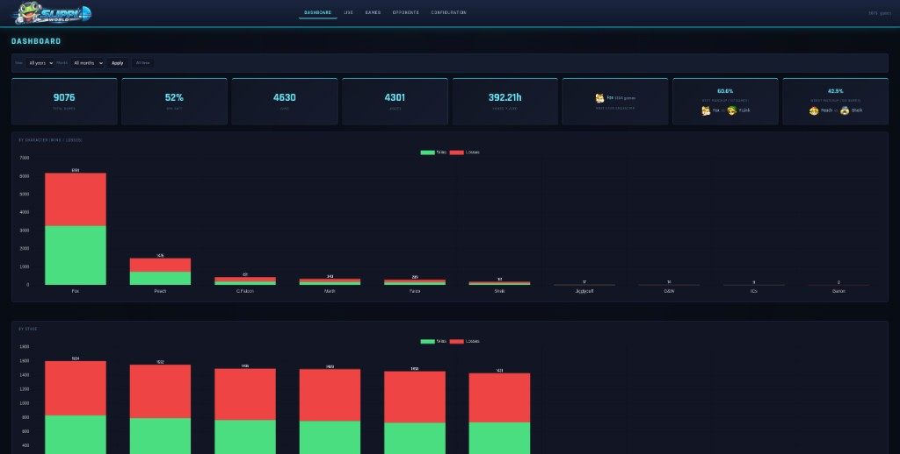
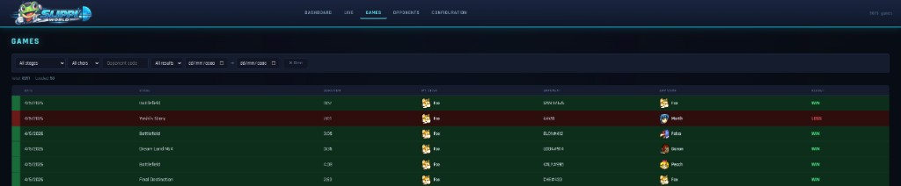
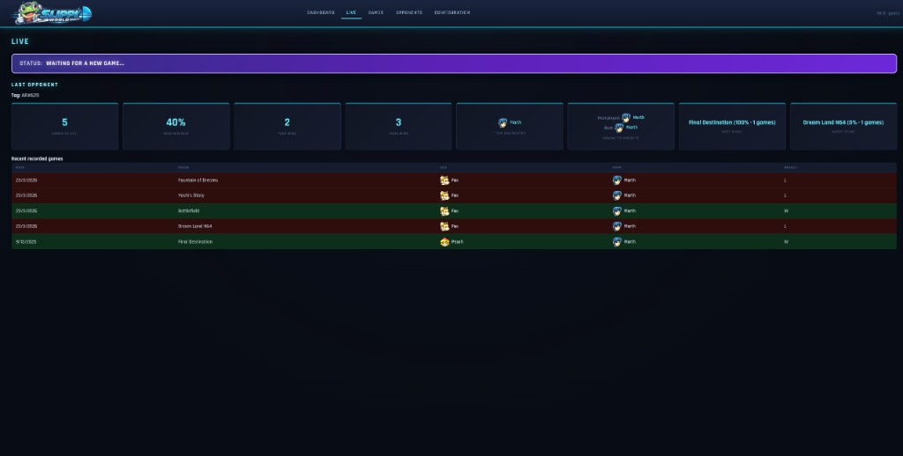
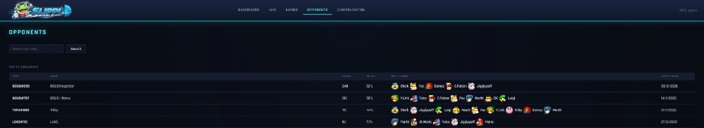

# Slippi World

Slippi World is a local app for analyzing Slippi replay data with dashboards, opponent insights, live context, and searchable match history.

The app runs fully on your machine using Bun + SQLite.

## Features

- Dashboard stats, trends, and your current/best Slippi ranked info
- LIVE opponent insights while playing, including current and best ranked data
- Games view with filters and infinite scroll
- Opponents page with top and recent tags, plus ranked columns (rank + ELO)
- Configuration page for connect codes, replay folders, and ingest
- Works with both **Slippi Dolphin** and **Melee Unlocked** replays and live games

## Screenshots

### Dashboard


### Games


### LIVE


### Opponents


## Tech Stack

- [Bun](https://bun.com) runtime and bundler
- TypeScript backend
- SQLite database
- Vanilla JS frontend + Chart.js

## Requirements

- Bun `>= 1.3.x`
- Slippi replay folders (`.slp`)

## Quick Start

```bash
bun install
bun run dev
```
Open `http://localhost:7474`.

Or install the app from GitHub Releases (Linux, Windows and macOS):

## GitHub Releases 

Download the latest build from the [Releases page](https://github.com/regiakb/slippi-world/releases/latest):

| OS | File |
| --- | --- |
| Linux x86_64 | `SlippiWorld-linux-x64.AppImage` |
| Windows (installer) | `SlippiWorld-Setup.exe` |
| Windows (portable) | `SlippiWorld-windows-x64.zip` |
| macOS Apple Silicon (M1/M2/M3/M4) | `SlippiWorld-macos-arm64.zip` |
| macOS Intel | `SlippiWorld-macos-x64.zip` |

**macOS**: unzip, move **Slippi World** (`SlippiWorld.app`) to Applications and open it. The app is not signed,
so the first time macOS Gatekeeper may block it: right-click → **Open** (or run
`xattr -dr com.apple.quarantine /Applications/SlippiWorld.app`). On macOS the database lives in
`~/Library/Application Support/slippi-world/`.

Build the release assets yourself (cross-builds from Linux):

```bash
bun run package:linux:appimage   # Linux AppImage
bun run package:windows:exe      # Windows installer + portable zip
bun run package:macos:zip        # macOS .app zips (arm64 + x64)
```

For a `.dmg`, run `scripts/package-macos-dmg.sh` on a Mac.

## How It Works

1. Add your connect code(s) and replay directories in **Configuration**.
2. Run **Ingest** to import games into the local database.
3. Use **Dashboard**, **Games**, **Opponents**, and **Live** for analysis in real time.

### Slippi Dolphin and Melee Unlocked

- **Replays**: player names and connect codes are read from the replay's Game Start block, with the end-of-file
  metadata as fallback. Slippi Dolphin writes both; Melee Unlocked only writes the Game Start block.
- **Live**: Slippi World connects to the emulator's Slippi spectator server (`127.0.0.1:51441`, the same feed the
  Slippi Launcher uses) and shows the match while it is being played. Melee Unlocked only writes the `.slp` file
  when the game ends, so this feed is what makes Live work there. In Melee Unlocked keep
  `slippi_spectator 1` in `port-settings.ini` (it is on by default). If the feed is not available, Live falls back
  to reading the newest `.slp` while it is being written (Slippi Dolphin).
  Override with `SPECTATOR_HOST`, `SPECTATOR_PORT`, or turn it off with `SPECTATOR=0`.
- **Moved replays**: a game is recognised by its start time, stage, length and characters, so moving replays into
  other folders (for example into `YYYY-MM` subfolders) no longer creates duplicates.

## Data Location

By default, the app stores SQLite data in OS-native paths:

- Linux: `~/.local/share/slippi-world/slippi-world.db`
- Windows: `%APPDATA%/slippi-world/slippi-world.db`
- macOS: `~/Library/Application Support/slippi-world/slippi-world.db`

You can override the DB path with `DB_PATH`:

```bash
DB_PATH=/custom/path/slippi-world.db ./dist/slippi-world-linux-x64
```
